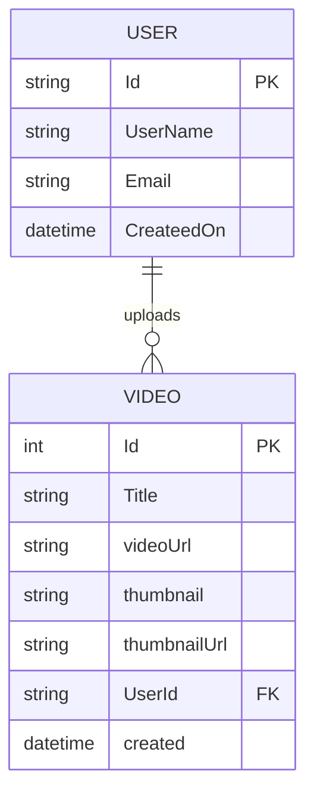

# CLIP

Clip is a web application for sharing gaming clips. Users can register, sign in, upload videos with thumbnails, browse clips, and manage their own uploads.

The project contains an Angular 15 frontend and an ASP.NET Core 10 Web API backed by PostgreSQL.

## Features

- User registration and login with ASP.NET Core Identity
- JWT-based authentication and token refresh
- Video upload with thumbnail
- Browse all videos, individual videos, videos by user, and recommendations
- Edit a video title and delete videos
- Static serving of uploaded videos and thumbnails
- Swagger UI in the Development environment

## Tech Stack

| Layer | Technology |
| --- | --- |
| API | ASP.NET Core 10 (`net10.0`) |
| ORM | Entity Framework Core 10 |
| Database | PostgreSQL 16  |
| Authentication | ASP.NET Core Identity + JWT Bearer |
| API docs | Swashbuckle / Swagger |
| Frontend | Angular 15, TypeScript, Tailwind CSS, Video.js |
| Local database | Docker Compose |


## Getting Started

### 1. Start PostgreSQL

From the repository root:

```bash
docker compose -f API/docker-compose.yaml up --build
```

To stop it:

```bash
docker compose -f API/docker-compose.yaml down
```

### 2. Apply database migrations

```bash
cd API
dotnet restore
dotnet ef database update
```

### 3. Run the API

Run from the `API` directory so relative paths such as `Resources/Uploads` resolve correctly:

```bash
cd API
dotnet run
```

The API is available at:

- HTTPS: `https://localhost:7120`
- HTTP: `http://localhost:5180`
- Swagger UI: `https://localhost:7120/swagger`

### 4. Run the Angular frontend

In a separate terminal:

```bash
cd Angular
npm install
ng serve
```

The frontend runs at `http://localhost:4200`. Its API calls are currently hard-coded to `https://localhost:7120`, so the API must be running on that URL with a trusted development certificate.

## Database and Migrations

It creates the ASP.NET Identity tables and the `Videos` table.

Common commands:

```bash
cd API

# Create a new migration after changing the model
dotnet ef migrations add <MigrationName>

# Apply pending migrations
dotnet ef database update


```

The previous SQL Server migrations were removed because EF Core migrations are provider-specific. This repository now has a fresh PostgreSQL baseline. 

## API Endpoints

### Account

| Method | Route | Authentication | Description |
| --- | --- | --- | --- |
| `POST` | `/api/Account/Register` | No | Register with `userName`, `email`, `password`, and `phoneNumber` |
| `POST` | `/api/Account/Login` | No | Sign in with `email` and `password`; returns user details and a JWT |
| `GET` | `/api/Account/Refresh-User-Token` | Bearer JWT | Returns the current user with a refreshed token |

### Videos

| Method | Route | Description |
| --- | --- | --- |
| `GET` | `/api/Video` | Get all videos |
| `GET` | `/api/Video/{id}` | Get one video |
| `GET` | `/api/Video/recommend/{id}` | Get up to three recommended videos |
| `GET` | `/api/Video/user/{userId}` | Get videos uploaded by a user |
| `POST` | `/api/Video` | Upload a video (`multipart/form-data`) |
| `PUT` | `/api/Video/{id}` | Update a video title |
| `DELETE` | `/api/Video/{id}` | Delete a video and its local files |

The upload endpoint expects these form fields:

| Field | Type | Description |
| --- | --- | --- |
| `VideoFile` | file | The video file |
| `thumbnail` | file | The thumbnail image |
| `UserEmail` | string | Email of the uploading user |
| `title` | string | Video title |


## Data Model



