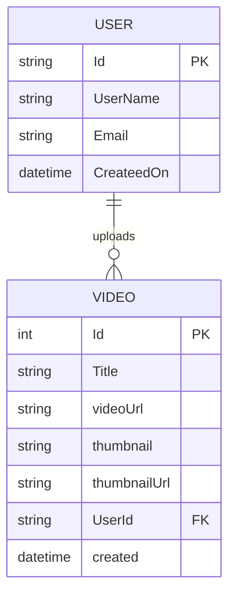

# CLIP

Clip is a web application for sharing gaming clips. Users can register, sign in, upload videos with thumbnails, browse clips, and manage their own uploads.

The project contains an Angular 22 frontend and an ASP.NET Core 10 Web API backed by PostgreSQL.

## Features

- User registration and login with ASP.NET Core Identity
- JWT-based authentication and token refresh
- Video upload with thumbnail
- Browse all videos, individual videos, videos by user, and recommendations
- Edit a video title and delete videos
- Static serving of uploaded videos and thumbnails
- Swagger UI in the Development environment

## Tech Stack

| Layer | Technology |
| --- | --- |
| API | ASP.NET Core 10 (`net10.0`) |
| ORM | Entity Framework Core 10 |
| Database | PostgreSQL 16  |
| Authentication | ASP.NET Core Identity + JWT Bearer |
| API docs | Swashbuckle / Swagger |
| Frontend | Angular 22, TypeScript 6, Tailwind CSS |
| Object storage | MinIO (S3-compatible API) |
| Local infrastructure | Docker Compose |


## Getting Started

### 1. Start PostgreSQL and MinIO

From the repository root:

```bash
docker compose -f API/docker-compose.yaml up --build
```

This starts:

- PostgreSQL on `localhost:5432` (application data)
- MinIO on `localhost:9000` (S3 API) with its console on `localhost:9001`

Uploaded videos and thumbnails are stored in MinIO and served through presigned URLs,
so MinIO must be running for thumbnails and playback to work.

To stop it:

```bash
docker compose -f API/docker-compose.yaml down
```

### 2. Apply database migrations

```bash
cd API
dotnet restore
dotnet ef database update
```

### 3. Run the API

Run from the `API` directory so relative paths such as `Resources/Uploads` resolve correctly:

```bash
cd API
dotnet run
```

The API is available at:

- HTTPS: `https://localhost:7120`
- HTTP: `http://localhost:5180`
- Swagger UI: `https://localhost:7120/swagger`

### 4. Run the Angular frontend

In a separate terminal:

```bash
cd Angular
npm install
npm start
```

The frontend runs at `http://localhost:4200`.

In development the frontend calls `/api/...` on its own origin; `Angular/proxy.conf.json`
forwards those requests to `https://localhost:7120`. Because the browser only talks to
`localhost:4200`, no certificate prompt appears for the API. The proxy is enabled by the
`serve` target, so always start the app with `npm start` / `ng serve`.

If you also want to call the API directly (Swagger, curl), trust the ASP.NET development
certificate once:

```bash
dotnet dev-certs https --trust
```

### 5. Frontend development scripts

```bash
cd Angular

npm start     # dev server with the /api proxy on http://localhost:4200
npm run build # production build
npm run lint  # ESLint (angular-eslint + typescript-eslint)
npm run format # Prettier for src/**/*.{ts,html,css}
```

`prefer-standalone`, `prefer-inject` and a few template accessibility rules are reported as
warnings on purpose; they are scheduled for a separate migration.

## Database and Migrations

It creates the ASP.NET Identity tables and the `Videos` table.

Common commands:

```bash
cd API

# Create a new migration after changing the model
dotnet ef migrations add <MigrationName>

# Apply pending migrations
dotnet ef database update


```

The previous SQL Server migrations were removed because EF Core migrations are provider-specific. This repository now has a fresh PostgreSQL baseline. 

## API Endpoints

### Account

| Method | Route | Authentication | Description |
| --- | --- | --- | --- |
| `POST` | `/api/Account/Register` | No | Register with `userName`, `email`, `password`, and `phoneNumber` |
| `POST` | `/api/Account/Login` | No | Sign in with `email` and `password`; returns user details and a JWT |
| `GET` | `/api/Account/Refresh-User-Token` | Bearer JWT | Returns the current user with a refreshed token |

### Videos

| Method | Route | Description |
| --- | --- | --- |
| `GET` | `/api/Video` | Get all videos |
| `GET` | `/api/Video/{id}` | Get one video |
| `GET` | `/api/Video/recommend/{id}` | Get up to three recommended videos |
| `GET` | `/api/Video/user/{userId}` | Get videos uploaded by a user |
| `POST` | `/api/Video` | Upload a video (`multipart/form-data`) |
| `PUT` | `/api/Video/{id}` | Update a video title |
| `DELETE` | `/api/Video/{id}` | Delete a video and its local files |

The upload endpoint expects these form fields:

| Field | Type | Description |
| --- | --- | --- |
| `VideoFile` | file | The video file |
| `thumbnail` | file | The thumbnail image |
| `UserEmail` | string | Email of the uploading user |
| `title` | string | Video title |


## Data Model



