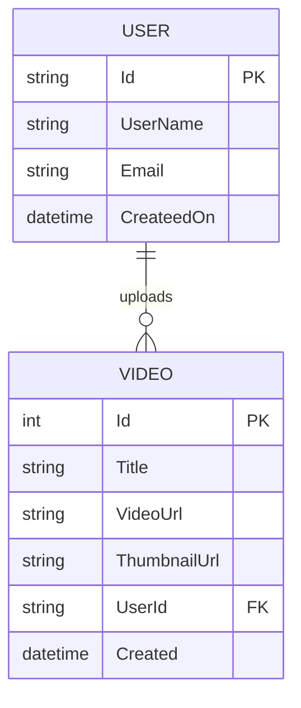

# CLIP

Clip is a web application for sharing gaming clips. Users can register, sign in, upload videos
with thumbnails, browse clips, and manage their own uploads.

The repository contains an Angular 22 frontend (`Angular/`) and an ASP.NET Core 10 Web API
(`API/`) backed by PostgreSQL, with MinIO (S3-compatible) for video and thumbnail storage.

## Features

- User registration and login with ASP.NET Core Identity
- JWT authentication with refresh
- Video upload (MP4, WebM, MOV) with a thumbnail generated in the browser
- Browse all clips, a single clip, and the signed-in user's clips
- Edit a clip title and delete clips (owner only)
- Videos and thumbnails stored in MinIO and delivered through presigned URLs
- Swagger UI in the Development environment

## Tech Stack

| Layer | Technology |
| --- | --- |
| API | ASP.NET Core 10 (`net10.0`) |
| ORM | Entity Framework Core 10 |
| Database | PostgreSQL 16 |
| Object storage | MinIO (S3-compatible API) |
| Authentication | ASP.NET Core Identity + JWT Bearer |
| API docs | Swashbuckle / Swagger |
| Frontend | Angular 22, TypeScript 6, Tailwind CSS |
| Code quality | ESLint (angular-eslint, typescript-eslint) + Prettier, strict TypeScript |
| Local infrastructure | Docker Compose |

## Prerequisites

| Tool | Version |
| --- | --- |
| .NET SDK | 10.0 |
| Node.js | 20.19+, 22.12+, or 24+ (Angular 22 requirement) |
| npm | ships with Node |
| Docker + Docker Compose | current release |
| `dotnet-ef` | 10.x — `dotnet tool install --global dotnet-ef` |

## Getting Started

### 1. Configure local secrets

The real secret files under `API/Env/` are git-ignored (only the `*.example` files are
committed), so a fresh clone must create these files:

| File | Start from |
| --- | --- |
| `API/Env/config.json` | `API/Env/config.json.example` |
| `API/Env/.env.postgres` | `API/Env/.env.postgres.example` |
| `API/Env/.env.minio` | `API/Env/.env copy.example` |

`config.json` has four sections. The values below match the local Docker stack; replace the
secrets with your own.

```json
{
  "ConnectionStrings": {
    "DefaultConnection": "Host=localhost;Port=5432;Database=clip_db;Username=clip_user;Password=clip_password"
  },
  "JWT": {
    "Key": "<at least 32 random characters>",
    "LifetimeMinutes": 1440,
    "Issuer": "https://localhost:7120",
    "Audience": "https://localhost:7120"
  },
  "S3": {
    "ServiceUrl": "http://localhost:9000",
    "AccessKey": "<MINIO_ROOT_USER>",
    "SecretKey": "<MINIO_ROOT_PASSWORD>",
    "BucketName": "clips-videos",
    "ForcePathStyle": true,
    "UseHttp": true,
    "PresignExpiryMinutes": 120
  },
  "Cors": {
    "AllowedOrigins": ["http://localhost:4200"]
  }
}
```

- The PostgreSQL user/password/database must match `API/Env/.env.postgres`.
- The S3 access/secret keys are the MinIO root credentials from `API/Env/.env.minio`.
- `UseHttp` is `true` because the local MinIO has no TLS; `ForcePathStyle` is required for MinIO.
- The API fails fast on startup if the JWT or S3 options are invalid.

### 2. Start PostgreSQL and MinIO

From the repository root:

```bash
docker compose -f API/docker-compose.yaml up -d
```

This starts:

- PostgreSQL on `localhost:5432` (application data)
- MinIO on `localhost:9000` (S3 API) with its console on `localhost:9001`

Uploaded videos and thumbnails live in MinIO and are served through presigned URLs, so MinIO
must be running for playback and thumbnails to work.

> The compose health check for MinIO reports `unhealthy` on images that ship without the `mc`
> binary. The service itself is fine — verify it with
> `curl http://localhost:9000/minio/health/live`.

### 3. Create the storage bucket (once per fresh MinIO volume)

The API does not create the bucket. Open <http://localhost:9001>, sign in with the credentials
from `API/Env/.env.minio`, and create a bucket named `clips-videos` (or whatever
`S3:BucketName` says). Keep it private — access goes through presigned URLs.

Without the bucket, uploads fail and thumbnails return 404.

### 4. Apply database migrations

```bash
cd API
dotnet restore
dotnet ef database update
```

### 5. Run the API

Run from the `API` directory so `Env/config.json` is found:

```bash
cd API
dotnet run
```

The API is available at:

- HTTPS: `https://localhost:7120`
- HTTP: `http://localhost:5180`
- Swagger UI: `https://localhost:7120/swagger`

### 6. Run the Angular frontend

In a separate terminal:

```bash
cd Angular
npm install
npm start
```

The frontend runs at `http://localhost:4200`.

In development the app requests `/api/...` on its own origin; `Angular/proxy.conf.json` forwards
those requests to `https://localhost:7120`. Because the browser only talks to `localhost:4200`,
no certificate prompt appears for the API. The proxy is configured on the `serve` target, so
always start the app with `npm start` / `ng serve`.

If you also call the API directly (Swagger, curl), trust the ASP.NET development certificate
once:

```bash
dotnet dev-certs https --trust
```

### 7. Frontend scripts and code quality

```bash
cd Angular

npm start      # dev server with the /api proxy on http://localhost:4200
npm run build  # production build into dist/clips
npm run lint   # ESLint (angular-eslint + typescript-eslint)
npm run format # Prettier for src/**/*.{ts,html,css}
```

`ng lint` must report **0 errors**. The remaining warnings are intentional and tracked for a
separate migration: `prefer-standalone`, `prefer-inject`, and a few template accessibility rules.

`prefer-on-push-component-change-detection` is switched off on purpose: most components keep
state in plain fields updated from subscriptions, and forcing `OnPush` without signals stops
their bindings from refreshing.

## Project Structure

```text
API/
  Controllers/      AccountController, VideoController
  DTOs/             request/response contracts
  Models/           User, Video
  Options/          JwtOptions, S3Options (validated at startup)
  Services/         JWT, video business logic, S3 storage
  Data/             ApplicationDbContext
  Migrations/       EF Core migrations (PostgreSQL)
  Validator/        upload validation attributes
  Env/              local secrets (git-ignored)

Angular/
  proxy.conf.json   dev proxy: /api -> https://localhost:7120
  src/environments/ environment.ts (production) + environment.development.ts
  src/app/
    shared/         alert, modal, tabs, interceptors, directives, API base URL
    user/           auth, login, register, services/, models/
    video/          upload, edit, manage, services/, model/
    clip/           single clip page
    clips-list/     home clip grid
    nav/, home/, about/, not-found/
    guards/         auth guard
    services/       modal service
```

### Frontend conventions worth knowing

- **Module-based**, not standalone (`standalone: false`); standalone migration is deferred.
- `ModalService` holds its modal list in a signal and is provided once at the root.
- `AlertService` is **provided per component** (login, register, upload, edit, manage), so a
  message shown on one page can never appear on another. `<app-form-alert />` renders it.
- API calls go through `shared/api-shared.ts`, which reads `environment.apiBaseUrl`.

## Configuration

| Build | Environment file | `apiBaseUrl` | Result |
| --- | --- | --- | --- |
| `ng serve` / development | `environment.development.ts` | `''` | same-origin `/api`, forwarded by the proxy |
| `ng build` (production) | `environment.ts` | `https://localhost:7120` | direct HTTPS calls |

The production environment still points at `https://localhost:7120`; change it before deploying
anywhere else.

CORS on the API allows the origins listed in `Cors:AllowedOrigins`. The dev proxy makes CORS
irrelevant for normal development, but it still matters for direct API calls.

## Database and Migrations

EF Core creates the ASP.NET Identity tables and the `Videos` table.

```bash
cd API

# Create a migration after changing the model
dotnet ef migrations add <MigrationName>

# Apply pending migrations
dotnet ef database update
```

The migrations are PostgreSQL-specific; the old SQL Server migration set was removed when the
project moved to PostgreSQL.

## API Endpoints

### Account

| Method | Route | Authentication | Description |
| --- | --- | --- | --- |
| `POST` | `/api/Account/Register` | No | Register with `userName`, `email`, `password`, `phoneNumber` |
| `POST` | `/api/Account/Login` | No | Sign in with `email` and `password`; returns the user and a JWT |
| `GET` | `/api/Account/Refresh-User-Token` | Bearer JWT | Returns the current user with a refreshed token |

### Videos

| Method | Route | Authentication | Description |
| --- | --- | --- | --- |
| `GET` | `/api/Video` | No | Get all videos |
| `GET` | `/api/Video/{id}` | No | Get one video |
| `GET` | `/api/Video/user` | Bearer JWT | Videos uploaded by the current user |
| `POST` | `/api/Video` | Bearer JWT | Upload a video (`multipart/form-data`) |
| `PUT` | `/api/Video/{id}` | Bearer JWT, owner | Update the video title |
| `DELETE` | `/api/Video/{id}` | Bearer JWT, owner | Delete the video and its MinIO objects |

The upload endpoint takes these form fields:

| Field | Type | Constraints |
| --- | --- | --- |
| `videoFile` | file | `.mp4`, `.webm`, `.mov`; max 500 MB |
| `thumbnail` | file | `.jpg`, `.jpeg`, `.png`; max 5 MB |
| `title` | string | required, max 200 characters |

The owner is taken from the JWT, not from the request body.

## Data Model



## Troubleshooting

| Symptom | Cause / fix |
| --- | --- |
| `502 Bad Gateway` on `http://localhost:4200/api/...` | The API is not running on `https://localhost:7120`. Start it with `dotnet run` in `API/`. |
| Thumbnails or playback fail with `ERR_CONNECTION_REFUSED` on port `9000` | MinIO is not running, or the `clips-videos` bucket is missing. |
| Browser warns about the API certificate | Use `npm start` (proxy) instead of calling `https://localhost:7120` directly, or run `dotnet dev-certs https --trust`. |
| `400` on register | The email or user name already exists. |
| API exits immediately on startup | `API/Env/config.json` is missing or an option failed validation (JWT key length, S3 fields). |
| `dotnet ef` not found | `dotnet tool install --global dotnet-ef`. |
